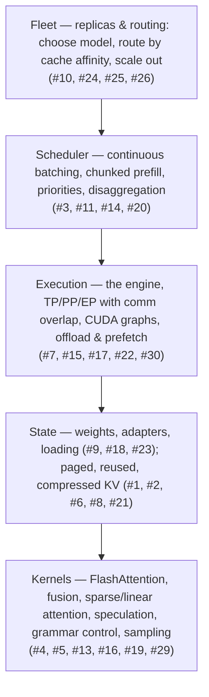

# LLM Inference Optimizations

**Status:** Reviewed + expanded reference
**Review date:** 2026-10-13
**Reviewer:** Mohammed Hoque (reviewed with GitHub Copilot, DeepSeek V4.1 Flash)
**Scope:** Model / serving-layer LLM inference engineering. App-layer concerns (semantic response caching, prompt compression, tokenizer design, hardware procurement) are listed as out of scope at the end.

---

## The pairs

### 1. KV Cache

**Problem:** LLMs are slow because autoregressive decoding recomputes attention over all previous tokens at every step.

**Solution:** KV Cache — store the key/value projections of previous tokens and reuse them at each decoding step instead of recomputing.

**Notes:**
- Only the *new* token's Q/K/V are computed per step; the new token attends over the cached keys/values plus itself.
- This turns decode into a memory-bandwidth problem (read weights + grown cache per token) — the root cause behind pairs #6, #9, #21.
- Universal across engines; cache layout is what PagedAttention (#2) manages.

### 2. PagedAttention

**Problem:** KV Cache consumes huge memory — naive allocation is fragmented and wasteful, and it grows unpredictably as sequences grow.

**Solution:** PagedAttention — manage KV memory in non-contiguous fixed-size blocks ("pages") with a per-sequence block table, like OS virtual memory, for efficient allocation and reduced fragmentation.

**Notes:**
- The vLLM paper measured <4% memory waste vs 60–80% in prior reservation-based allocators.
- Enables sharing: parallel sampling and beam search share blocks copy-on-write.
- Enables preemption: under memory pressure the scheduler can swap a sequence's blocks out or recompute them later.
- Now the default model in most engines (vLLM, TensorRT-LLM, TGI, SGLang).

### 3. Continuous Batching (a.k.a. Iteration-level Scheduling)

**Problem:** The GPU is underutilized: with static, request-level batching, short requests wait for long ones to finish and the batch drains before refilling.

**Solution:** Continuous batching — re-decide the running batch at every decoding iteration, so new requests join and finished ones leave mid-generation ("iteration-level scheduling" in the Orca paper; "in-flight batching" in TensorRT-LLM).

**Notes:**
- This absorbs supplied item B2 (see #12): the two names describe the same mechanism.
- Requires cheap per-sequence memory growth/shrink — i.e., it depends on paged KV (#2).
- Typical effect: order-of-magnitude throughput gains over naive static batching at equal latency (see Orca, OSDI '22; Hugging Face TGI's continuous-batching results).
- Coarser cousin: API-level "dynamic batching" with a timeout window — much smaller gains.

### 4. Speculative Decoding

**Problem:** Token generation is sequential — one forward pass per token, each pass reading the entire model.

**Solution:** Speculative decoding — a cheaper drafter (small model, n-gram lookup, or extra prediction heads) proposes k tokens; the target model verifies all k in a single parallel forward pass and accepts the longest correct prefix.

**Notes:**
- Speedup ≈ accepted tokens per target pass; it collapses when acceptance is low or the drafter is expensive. It helps most in the memory-bound (small-batch) regime and little when the GPU is compute-saturated.
- Output distribution is preserved with proper rejection sampling (greedy speculation ≡ greedy target output).
- Variants: Medusa (multiple decoding heads; 2.2–3.6× reported), EAGLE (feature-level drafting; 2.7–3.5× on LLaMA2-70B), n-gram / prompt-lookup (great for summarization/code editing), self-speculation, and DeepSeek-V3's MTP heads.
- Tuning: proposal length k, acceptance rate, drafter cost; interacts with batching and sampling.
- **Adaptive / dynamic speculation:** a fixed k is a static bet on acceptance — too small on easy traffic (speedup left on the table), a rejected-token tax on hard traffic. Runtime schemes adapt from measured acceptance: acceptance predictors that set k (SpecDec++-style), confidence-guided draft trees (EAGLE-2), drafter switching per workload, and engine auto-tuning. Re-validate when the workload mix shifts (#27).

### 5. FlashAttention

**Problem:** Attention requires large memory and expensive memory movement — naive implementations materialize the N×N score matrix in HBM and read/write it repeatedly.

**Solution:** FlashAttention — IO-aware, *exact* attention: tile Q/K/V into on-chip SRAM, fuse softmax into one pass, and never materialize the full score matrix in HBM.

**Notes:**
- Reduces HBM traffic and attention memory (O(N) instead of O(N²)); it does **not** reduce FLOPs — the win is fixing the memory-bound bottleneck.
- Generations: FA-2 (better parallelism/work partitioning), FA-3 (Hopper asynchrony + FP8; 1.5–2× over FA-2), FlashDecoding (split-KV parallelism for long-context decode).
- Standard in every modern engine; pairs with fusion (#13).

### 6. MQA / GQA (Multi-Query / Grouped-Query Attention)

**Problem:** The KV Cache is still large even with paging — every attention head stores its own keys and values.

**Solution:** MQA / GQA — share key/value heads across multiple query heads. MQA uses a single KV head (max saving, some quality loss); GQA groups query heads into G KV heads (e.g., 8:1 in Llama-3 70B) with near-MHA quality.

**Notes:**
- This is a pretraining-time architecture decision (it changes parameters), not a serving-time switch.
- Directly cuts both KV memory and the KV bytes read per decode step (KV loads dominate decode arithmetic intensity).
- Extension — **MLA (Multi-head Latent Attention)**: DeepSeek-V2/V3 compress KV into a low-rank latent vector (≈93% KV reduction vs MHA, with quality at or above MHA); projections can be absorbed into weights for efficient decode. Related: cross-layer KV sharing (YOCO, CLA). These belong to the same "KV cache is too large" family as this pair.

### 7. Integrated Serving Engines (vLLM and peers)

**Problem:** Individually great techniques are easy to get wrong in combination — scheduling, paged memory, batching, caching, kernels and quantization must all cooperate to actually get GPU utilization.

**Solution:** Production inference engines that bundle them: vLLM (PagedAttention, continuous batching, prefix caching, chunked prefill, speculative decoding, quantization, guided decoding, multi-LoRA, CUDA graphs), plus SGLang, TensorRT-LLM, TGI, LMDeploy.

**Notes:**
- The supplied framing ("many optimizations need to work together → vLLM") is right in spirit; the real problem statement is *integration*.
- All pairs in this document are, in practice, features you enable or tune *inside* one of these engines.
- Choose by ecosystem: vLLM (broadest OSS), SGLang (RadixAttention + structured generation), TensorRT-LLM (NVIDIA-optimized, FP8), TGI (HF stack).

### 8. RadixAttention / Prefix Caching

**Problem:** Applications repeatedly process the same prefixes — system prompts, chat history, few-shot examples, shared RAG contexts.

**Solution:** RadixAttention / prefix caching — cache and reuse previously computed KV states for shared prompt prefixes. SGLang uses a radix tree with LRU eviction; vLLM has Automatic Prefix Caching over hashed blocks (on by default in vLLM V1).

**Notes:**
- Cuts TTFT and prefill compute proportionally to hit rate; also improves throughput by removing redundant prefill work.
- Cloud APIs sell the same idea as "prompt caching" discounts.
- Hit rate depends on multi-replica routing — see #25 (cache-aware routing) for the fleet-level consequence.

### 9. Quantization

**Problem:** Models are too large to fit (or run fast) in native precision — weights and KV eat memory and bandwidth.

**Solution:** Quantization — reduce weight/activation precision to cut memory and increase speed. Categories: weight-only (W4A16: GPTQ, AWQ, GGUF; INT4 via Marlin kernels), weight+activation (W8A8: SmoothQuant, LLM.int8()), FP8 (Hopper-era tensor cores; near-lossless), and KV-cache quantization (FP8/INT8 KV).

**Notes:**
- Primary wins: memory footprint and decode bandwidth (decode is bandwidth-bound); compute speedups come when kernels exploit low-precision tensor cores.
- **Why naive quantization fails — activation outliers:** a handful of activation channels ("massive activations") carry far larger magnitudes than the rest; in naive W8A8 they consume the dynamic range and wreck accuracy. Both fixes are in the technique list above: migrate the outlier scale into the weights (SmoothQuant) or keep outlier dimensions in higher precision (LLM.int8()'s mixed-precision decomposition). Weight-only W4A16 (GPTQ/AWQ) fails differently — calibration and group-size granularity matter more.
- Requires accuracy validation per model and workload (perplexity + task evals), plus calibration data for some methods.
- Interacts with speculative decoding (draft precision), LoRA (#23) and KV compression (#21).

### 10. Smaller & Cheaper Models (Distillation / SLMs / MoE)

**Problem:** Running frontier-scale dense models for every request is too expensive.

**Solution:** Three distinct levers: (1) distillation — train a smaller student from a larger teacher; (2) small language models — use modern pretrained SLMs where the task allows (Phi, Gemma, Qwen-class); (3) MoE — route tokens through a sparse subset of experts to cut FLOPs per token while keeping total capacity.

**Notes:**
- The supplied pair conflated the three; they compose but are different economic levers.
- MoE caveats: all experts must live in memory (memory footprint can *grow*), routing imbalance, all-to-all communication (see #17), and batch-size economics.
- Pair with routing (#24) so each request hits the cheapest model that meets quality.

### 11. Chunked Prefill

**Problem:** A long prefill monopolizes the batch — decode steps stall behind it and peak activation memory spikes.

**Solution:** Chunked prefill — split the prompt into fixed token-budget chunks and co-schedule those chunks with ongoing decode steps in the same batch (vLLM's `max_num_batched_tokens`; Sarathi-Serve's "stall-free" chunked prefills).

**Notes:**
- **Wording fix:** chunks do not "overlap"; the overlap is between prefill work and decode work in one iteration. There is no FLOP reduction.
- Main wins: smooth inter-token latency (decodes are not blocked), bounded peak memory, higher achievable batch sizes; small tradeoff in scheduler tuning and tail TTFT under load.
- Sarathi-Serve reported up to 2.6× serving capacity (Mistral-7B, single A100) and 5.6× with pipeline parallelism (Falcon-180B).
- The lightweight alternative to full prefill/decode disaggregation (#20).

### 12. Iteration-level Scheduling — *Merged*

**Merged with #3.** "Iteration-level scheduling" (Orca, OSDI '22) is the same mechanism as continuous batching: the scheduler re-decides which requests are in the running batch at every decoding iteration. Kept as a placeholder here so the supplied numbering (core set 1–10, additional set 11–20) maps cleanly.

### 13. Kernel Fusion / Operator Fusion

**Problem:** During decoding, the model is memory-bandwidth-bound; every unfused operator forces an extra round-trip of activations to HBM.

**Solution:** Kernel fusion — combine multiple operations into single GPU kernels (e.g., QKV projections, LayerNorm + residual + activation, RoPE + attention, MoE dispatch/combine, sampling) to eliminate intermediate reads/writes.

**Notes:**
- Done by hand (engine kernels) or by compilers (torch.compile, TensorRT, XLA).
- Complements FlashAttention (#5), which is attention-specific fusion; distinct from CUDA graphs (#22), which remove *launch* overhead rather than memory traffic.
- Watch register pressure/occupancy — fusion can hurt if overdone.

### 14. Sequence Packing / Variable-length Batching

**Problem:** Batches contain requests with very different sequence lengths; padding to the longest wastes compute and skews scheduling.

**Solution:** Variable-length (ragged) batching / sequence packing — process multiple lengths in one flattened batch with varlen attention kernels (`cu_seqlens`-style) or bucket similar lengths together; pack training/offline datasets the same way.

**Notes:**
- **Nuance:** in modern engines with paged KV + varlen attention kernels, padding waste is already largely designed out; the pair matters most for batched *prefill*, non-paged stacks (HF `generate`, xFormers-style kernels), and sequence-packing for training.
- Length bucketing also improves load balance across replicas.
- Related to chunked prefill (#11): both shape how prefill work enters the batch.

### 15. Asynchronous Prefetch / Overlapped Offload

**Problem:** Offloading parts of the model or KV cache to CPU memory/disk is slow — PCIe (~64 GB/s) and NVMe are an order of magnitude slower than HBM (~3 TB/s on an H100).

**Solution:** Asynchronous prefetch and double-buffering — overlap CPU→GPU transfers with compute (prefetch layer n+1's weights or future KV blocks while computing layer n), so the GPU rarely stalls.

**Notes:**
- Precedents: FlexGen (GPU/CPU/disk aggregation, up to 4-bit cache compression), DeepSpeed ZeRO-Inference, llama.cpp offloading.
- Best when GPU memory is the binding constraint (huge model, low QPS, long context); latency variance and complexity are real costs.
- Same machinery powers KV offload/tiering (#21) and disaggregated KV transfer (#20).

### 16. Constrained Decoding / Grammar-guided Generation

**Problem:** Generating structured output (JSON, function calls, DSLs) by free sampling wastes tokens on invalid paths and requires retries.

**Solution:** Constrained decoding — enforce the output structure at decoding time by masking logits so only grammar-valid tokens are considered (regex/JSON-schema engines such as Outlines/XGrammar; grammar engines such as Guidance; built into vLLM's guided decoding and SGLang).

**Notes:**
- Net effect: guaranteed-valid output, fewer retries, usually fewer total tokens.
- Caveats: per-step mask computation can add latency (XGrammar reports near-zero overhead through vocabulary pre-checking and engine co-design); grammar compile time; slight quality tradeoffs vs unconstrained generation.
- Jump-forward decoding skips deterministic spans of the FSM for extra speed.

### 17. Model Parallelism (TP / PP / SP / EP)

**Problem:** A model does not fit on one GPU (capacity) and/or more compute is needed to hit latency targets — but splitting work across devices adds communication overhead.

**Solution:** Parallelism strategies matched to topology: tensor parallelism (split tensors, all-reduce per layer — keep intra-node on NVLink), pipeline parallelism (split layers, point-to-point between stages, micro-batching to reduce bubbles), sequence/context parallelism (split long sequences), expert parallelism (split MoE experts, all-to-all — see DeepEP-style kernels).

**Notes:**
- **Reframed problem:** communication overhead is the *second* problem; capacity/latency is the first. Different strategies trade differently (TP = latency-oriented, PP = throughput/scale-out, EP = MoE-specific).
- Interconnect matters: TP across slow links is usually a mistake; overlap communication with compute wherever possible (#30).
- Real deployments mix: e.g., 8-way TP per node × PP across nodes. Tune NCCL configuration.

### 18. Cold Starts & Fast Model Loading

**Problem:** Cold starts and model loading take too long — serverless/scale-to-zero deployments pay minutes before the first token.

**Solution:** Keep weights resident where you can (warm replicas or pools, scale-to-zero only where the economics justify it) and make loading cheap where you must: mmap-friendly weight formats (SafeTensors — no deserialization, no pickle code execution), precompiled engines/graph caches baked into the image (TensorRT plans, torch.compile caches), local NVMe caches of weights, and readiness gating.

**Notes:**
- **Wording fix:** "near-instant loading" is overstated. Even with mmap, a 70B model (~140 GB) is bounded by storage bandwidth (tens of seconds at NVMe speeds). mmap helps most when weights are already in the OS page cache.
- Biggest wins: avoid re-downloading/re-serializing weights; reuse compiled artifacts; keep a warm floor for latency-critical services.
- Related: persistent KV/prefix caches (#8) survive process restarts only if explicitly persisted — usually not worth it vs warm replicas.

### 19. Sub-quadratic Attention (Sliding Window / Sparse / Linear)

**Problem:** Attention over very long contexts is still quadratic in compute and grows KV memory linearly with length.

**Solution:** Change the attention pattern itself: sliding-window attention (Mistral-style local windows), sparse patterns (Longformer, BigBird — local + global tokens), linear/SSM variants (linear attention, Mamba) and modern trainable sparse attentions (DeepSeek NSA, MoBA).

**Notes:**
- Trades long-range recall for cost; quality and wall-clock gains vary with kernel-friendliness — hybrid stacks (some full-attention layers) are common in production models.
- Complements FlashAttention (#5): FA fixes *how* attention is computed (memory traffic); this pair changes *how much* attention is computed.
- Runtime counterparts (eviction of an existing full-attention model's KV) are in #21.

### 20. Priority Queues + Disaggregated Prefill/Decode

**Problem:** Serving mixed workloads (high-throughput batch + low-latency interactive) on the same GPUs is hard: long prefills stall decodes (interference), and one latency SLO usually gets sacrificed.

**Solution:** Two tiers of fixes: (a) request prioritization/preemption for SLOs; (b) disaggregation — run prefill and decode on separate hardware pools (DistServe, Splitwise) with KV transfer between them (Mooncake, LMCache, NIXL, NVIDIA Dynamo), scaling each pool and phase independently.

**Notes:**
- Root issue: prefill is compute-bound, decode is memory-bound; co-locating them couples their optimal configurations and creates interference.
- DistServe reported 7.4× more requests (or 12.6× tighter SLO) vs phase-colocated serving; Splitwise reported 1.4× throughput at 20% lower cost.
- Heavy-duty fix = disaggregation; light fix = chunked prefill (#11) + priorities.
- New cost: KV movement between pools (fast interconnects required), scheduling complexity, pool sizing.

### 21. KV Cache Compression & Tiering at Runtime

**Problem:** Even with paging (#2) and architectural shrinking (#6), KV cache grows linearly with context length × concurrency — long chats, long documents and big batches exhaust GPU memory long before weights do.

**Solution:** Compress or move the cache at runtime:
- **Eviction / sparsity:** keep attention sinks + recent tokens (StreamingLLM), evict by attention scores (H2O heavy hitters), or select KV during prefill via an observation window (SnapKV).
- **KV quantization:** FP8/INT8 KV caches (usually small quality impact).
- **Tiering/offload:** push cold KV to CPU DRAM / NVMe and fetch asynchronously (LMCache, Mooncake-style disaggregated cache).

**Notes:**
- Order of application: KV quantization first (cheapest, low risk), then eviction policies (needs long-context evals — naive eviction breaks retrieval), then offload/tiering (latency and complexity cost).
- These are the runtime complement to architectural fixes; all can be combined with prefix caching (#8) — but eviction policies and prefix reuse interact (evicted blocks can't be reused).
- Reported: H2O keeps ~20% ("heavy hitter") tokens; SnapKV reported 3.6× generation speed and 8.2× memory efficiency at 16K tokens.

### 22. CUDA Graphs & Low-overhead Execution

**Problem:** At small/medium batch sizes, decoding is dominated by per-kernel launch and framework overhead — hundreds of tiny kernels per token, each a few microseconds of math and a few microseconds of launch gap. The GPU starves on overhead, not compute.

**Solution:** Capture the whole decode step as a CUDA Graph and replay it (near-zero launch cost); use compiled/fused execution (torch.compile `reduce-overhead`, TensorRT engines) and overlap host-side scheduling with GPU execution (async scheduling in vLLM V1 and SGLang).

**Notes:**
- Standard in modern engines (vLLM, TensorRT-LLM, SGLang); the single biggest win for low-latency single-stream serving.
- Requirement: static shapes → batch-size "buckets" with padding; some dynamic features (certain speculative paths, LoRA hot-swap) need fallbacks outside the graph.
- Complements fusion (#13): fusion removes memory round-trips; graphs remove launch overhead.

### 23. Multi-LoRA / Adapter Serving

**Problem:** Many tenants, tasks or personalizations need fine-tuned variants — a full model copy per variant is memory-, startup- and ops-prohibitive.

**Solution:** Serve one base model with many dynamically loaded LoRA adapters: batch requests across adapters in one step (Punica's SGMV kernels), manage thousands of adapters with unified memory paging (S-LoRA), and hot-load/evict adapters per tenant (built into vLLM and SGLang).

**Notes:**
- Reported: Punica 12× throughput vs naive multi-model serving at +2 ms/token; S-LoRA up to 4× throughput vs naive LoRA serving and orders-of-magnitude more served adapters.
- Watch: adapter pool VRAM budget, hot-swap latency, rank choice (rank trades quality vs memory).
- Accuracy is equivalent to merged adapters if computed correctly — it is a serving optimization, not a quality tradeoff.

### 24. Model Routing & Cascades

**Problem:** Sending every request to the largest model wastes cost and latency; a large share of production traffic is easy.

**Solution:** Route by predicted difficulty: cascades (run a small model first; escalate on low confidence / verifier failure), learned routers (RouteLLM, FrugalGPT), and per-request "effort" knobs (reasoning budgets, max-token caps). On-prem, run a heterogeneous pool of model sizes behind one gateway.

**Notes:**
- Reported: FrugalGPT matched the best single LLM (GPT-4-class) at up to 98% cost reduction in its evaluations; RouteLLM routers cut cost >2× at comparable quality on benchmarks.
- Needs quality guardrails: validate routing decisions with evals and monitor escalations; router overhead must stay small vs saved cost.
- Composes with SLMs/distillation (#10) and multi-LoRA (#23); on GPU fleets it pairs with model-sharding decisions (#17).

### 25. Cache-aware / Prefix-affinity Routing

**Problem:** Prefix caching (#8) is only as good as routing: with blind round-robin, every replica has a different warm cache and fleet-wide hit rate collapses — users re-pay full prefill while caches sit idle.

**Solution:** Route by prefix affinity: hash the prompt prefix and send it to the replica holding (or most likely to hold) its KV — plus load-aware fallback. Implementations: vLLM production-stack prefix-aware router, SGLang cache-aware scheduling, NVIDIA Dynamo KV-aware routing; with a shared KV store, route to *any* replica that can fetch the KV blocks cheaply.

**Notes:**
- Biggest wins for multi-turn chat, agent loops, and multi-tenant workloads with shared system prompts.
- Combine with consistent hashing; handle replica churn under autoscaling (cache dies with the replica — weight the route toward stability).
- Related: disaggregated KV storage (#20/#21) turns this from "affinity" into "retrieval".

### 26. Fleet Scale-out — Data Parallelism, Autoscaling & Tail Latency

**Problem:** A single replica has one queue and one failure domain, and #17's menu (TP/PP/SP/EP) skips the default scale-out axis: replicas. Bursty demand, replica churn and tail latency (one slow replica, one overloaded queue) then dominate p99 while fleet averages look healthy.

**Solution:** Scale out with data-parallel replicas behind a gateway that already routes by model (#24) and cache affinity (#25); autoscale on queueing signals against TTFT/ITL SLOs and keep a warm pool so scale-up is not a cold start (#18). Manage tails explicitly: health-aware routing, request cancellation for runaway generations, load shedding / priority classes (#20), and hedged requests for short latency-critical outputs (send a duplicate, take the first, cancel the loser). Also note DP *inside* a model: MoE serving commonly runs data-parallel attention alongside expert parallelism (DP-attention + EP), which is a separate decision from replica-level DP (#17).

**Notes:**
- Rule of thumb: TP for latency within a node (bounded by the NVLink domain), DP for throughput and fault isolation beyond it, PP to bridge a model across nodes (#17). Mixed deployments re-decide per model.
- Autoscaling and prefix caching pull against each other: scale-in destroys local caches (#25). Prefer stable routing, shared or disaggregated KV (#20, #21), or accept the cache loss only where the economics justify it (#18).
- Hedging buys p99 with extra compute — worthwhile for short outputs, rarely worth it for minute-scale generations (#28); cancel the loser promptly so its GPU work is actually released.
- Capacity planning lives here: size (and report) replicas for goodput at the SLO (#27), not for peak tokens/s.

### 27. Measurement & Profiling Methodology

**Problem:** Serving benchmarks mislead by default: tokens/s with no latency constraint, warm caches vs cold, one stream vs a saturated fleet, averages instead of p99, unreported engine flags — so change-verification is untrustworthy and published numbers rarely transfer to your workload.

**Solution:** Use and report a fixed protocol: define the operating point (latency at a stated concurrency, or throughput/goodput against an SLO); control state (cold vs warm prefix cache, fixed prompt/output-length mix); warm up, repeat, and report distributions, not means; capture the configuration (engine and version, quantization, KV dtype, batch-token/sequence caps, speculation k, hardware); attribute with profilers (Nsight Systems, torch profiler) when you need to know *why*; and use standard harnesses (LLMPerf, NVIDIA genai-perf, vLLM `benchmark_serving`) so results are comparable.

**Notes:**
- Latency-optimal and throughput-optimal settings are different deployments of the same engine — measure both ends of the curve and choose per SLO. "X tokens/s" without concurrency, caps and SLO attached is meaningless.
- Engine defaults are safe, not optimal: batch-token and sequence caps, `gpu_memory_utilization`, prefix caching, and speculation are the usual sweep candidates (#11, #22).
- Treat every other pair's claims as hypotheses to verify on your workload: quantization needs accuracy evals (#9, #21); eviction policies need long-context retrieval tests (#21); routing needs escalation monitoring (#24).
- Watch artifacts: CUDA-graph capture and cache warmup inflate short runs; client-side detokenization pollutes ITL; gateway and network hops belong in end-to-end SLO numbers (#26).

### 28. Reasoning / Long-CoT Serving Economics

**Problem:** Reasoning-class models invert the workload profile: thinking traces of thousands of tokens make decode the dominant cost, KV grows and stays live for minutes, batch slots stay occupied, and capacity plans built on prefill-heavy chat numbers are wrong by construction.

**Solution:** Treat output length as the primary capacity variable: bound it (reasoning-effort budgets, max-token caps, budget forcing, early-answer termination — #24), route by required reasoning depth (#10, #24), and invest in the decode path that now dominates — KV quantization/tiering (#21), speculation where acceptance holds (#4), CUDA graphs (#22), chunked prefill sized so long prefills do not stall long decodes (#11), and disaggregation for strict SLOs (#20). Keep prefix caching (#8, #25) for reused system/tool prefixes, but expect prefill's share of total cost to shrink as outputs grow.

**Notes:**
- Budget enforcement needs eval coverage: verify accuracy holds when thinking is capped (#27); overthinking is a real cost, but so is underthinking.
- ITL is the felt metric at minute scale (TTFT amortizes over a long generation), and p99 ITL across a long trace is a much stricter bar than across a short answer — benchmark reasoning-length distributions, not chat-length ones (#27).
- Speculation must be re-validated: acceptance rates measured on chat benchmarks do not transfer for free to long CoT, and the drafter competes for the same memory the KV cache needs (#4, #21).
- Batching economics shift: a few long traces can hold the batch for minutes, so fairness/aging between short interactive traffic and long CoT traffic matters (#3, #20) — and hedged duplicates (#26) rarely pay off.

### 29. Sampling & Output-side Cost

**Problem:** The decode path does not end at logits: every step runs the sampler — softmax over a 128K–256K vocabulary, top-k/top-p selection, logits processors (repetition/presence/frequency penalties, bad-words masks) that scan the vocab per sequence per step, grammar masks (#16), and beam/best-of-n bookkeeping. Naive implementations copy full-vocab logits to the CPU and run Python-level processors and sorts — overhead that scales with concurrency × steps and hides inside ITL.

**Solution:** Keep sampling on-GPU and fused (FlashInfer-style sampling kernels, batched processor execution), use rejection-based top-p variants instead of full sorts where available, precompile and cache grammar masks so constrained decoding does not pay per-step mask work (#16), take the greedy fast path when a request allows it, and fold sampling into the captured step under CUDA graphs (#22) where shapes are static.

**Notes:**
- The sampler shares the step budget with the model: throughput-driven tuning (bigger batches, more sequences — #22) raises sampler pressure too — profile and attribute before assuming the model is slow (#27).
- Structured output (#16) is usually a net win: paying mask work per step to avoid retry loops beats free sampling plus invalid retries.
- Speculation (#4) moves sampling work as well: rejection/verification sampling must stay exact or the target distribution breaks — correctness first, then speed.
- Audit defaults: unused logit processors and grammar checks still cost per step — turn off what the workload does not need.

### 30. Scaling Efficiency — Communication–Computation Overlap

**Problem:** Once capacity is solved (#17), scale-out hits a second wall: per-GPU compute shrinks with every added device, but collective latency does not — TP adds all-reduces per layer, EP adds dispatch/combine all-to-all — so the fleet spends a growing share of each step waiting on the fabric (the "scaling wall"), and per-GPU throughput can fall as devices are added.

**Solution:** Overlap communication with computation instead of serializing them: chunk collectives so the next layer's compute is pipelined behind the current layer's synchronization; use low-latency expert dispatch/combine kernels (DeepEP) and co-schedule MoE communication with attention/GEMM work; keep TP collectives inside the NVLink domain and cross-node traffic on the best available fabric, topology-aware (#17); shrink what goes on the wire where supported (coalesced and lower-precision collectives). Track scaling efficiency — tokens/s per GPU vs. GPU count — as a first-class metric, not just absolute throughput.

**Notes:**
- This is #17's "second problem" made concrete: capacity/latency strategy first, then scaling efficiency. Same overlap mindset as #15 (hiding transfers behind compute), applied to collectives.
- Bidirectional and micro-batch pipeline schedules (DualPipe-style) attack the same wall at the pipeline level; disaggregated deployments add KV transfer to the overlap problem (#20).
- Interacts with #22 (CUDA graphs): graphs want static shapes and capture streams, while chunked/async communication is dynamic — overlap and graph capture should be co-designed, not stacked blindly.
- Overlap is not free: communication work consumes SM time and register/shared-memory budget, and deep chunking adds launch and synchronization overhead. Profile the communication breakdown (Nsight, NCCL tests) before tuning (#27).

---

## How the pieces fit together

### The two phases explain everything

LLM serving has two phases with opposite bottlenecks:

- **Prefill** (process the prompt): compute-bound — big parallel GEMMs, good GPU utilization, latency shows up as **TTFT** (time to first token).
- **Decode** (generate tokens): memory-bandwidth-bound — one token per forward pass, reads all weights + KV per token, latency shows up as **ITL/TPOT** (inter-token latency).

Nearly every technique targets one phase or the boundary between them: quantization (#9), KV fixes (#1, #2, #6, #21) and batching (#3) mainly help decode; chunked prefill (#11) and disaggregation (#20) manage the interference between phases; speculative decoding (#4) injects parallel compute into the bandwidth-bound phase. Reasoning-class models push the mix further toward decode — long thinking traces make the decode-side pairs the dominant lever (#28).

### Recommended combination (roughly in order of impact)

1. A production engine (#7) with paged KV (#2), continuous batching (#3) and prefix caching (#8) — the baseline.
2. Quantized weights for your hardware (FP8 or INT4; #9) and quantized KV (#21) if memory-pressured.
3. Tuned chunked prefill (#11) and CUDA graphs (#22).
4. Speculative decoding (#4) if single-stream latency matters more than peak throughput.
5. Multi-LoRA (#23) if many variants; model routing (#24) + cache-aware routing (#25) across replicas.
6. Disaggregated prefill/decode (#20) at large scale / strict SLOs.
7. Beyond one replica: DP scale-out with SLO-aware autoscaling and tail-latency mitigations (#26); keep caches warm across scale events (#25).

**Cross-cutting:** verify every change with a fixed measurement protocol (#27); plan capacity around the decode-heavy reasoning token mix (#28); account for output-side sampling cost (#29) when chasing ITL; and track scaling efficiency as you add nodes (#30).

### Metrics to judge with

- **TTFT** (time to first token) — dominated by prefill and queueing.
- **ITL / TPOT** (inter-token latency / time per output token) — dominated by decode efficiency.
- **Throughput** — tokens/s and requests/s per GPU; **goodput** = throughput while meeting an SLO.
- Practical knobs: max batched tokens (chunk size), max concurrent sequences, GPU memory utilization target, KV dtype, speculation length k, prefix-cache size.

### Out of scope here (deliberately)

- App-layer caching (exact-match or semantic response caches) and prompt compression.
- Tokenizer/vocabulary design and context-window position scaling (YaRN/NTK).
- Hardware selection and cluster procurement (only interconnect constraints were noted, #17).

---

## 4. References

Primary sources for numbers and claims cited above. Lightly grouped; arXiv IDs were verified during this review where included.

**Attention & kernels**
- FlashAttention (arXiv:2205.14135); FlashAttention-2 (arXiv:2307.08691); FlashAttention-3 (arXiv:2407.08608)
- Longformer (arXiv:2004.05150); BigBird (arXiv:2007.14062)
- Mamba (arXiv:2312.00752)
- XGrammar (arXiv:2411.15100)
- FlashInfer — attention & sampling kernels (library)

**KV cache & memory**
- PagedAttention / vLLM (arXiv:2309.06180)
- Multi-Query Attention, Shazeer 2019 (arXiv:1911.02150); GQA (arXiv:2305.13245)
- DeepSeek-V2 paper — MLA (arXiv:2405.04434); DeepSeek-V3 — MTP (arXiv:2412.19437)
- YOCO, cross-layer KV sharing (arXiv:2405.05254)
- StreamingLLM (arXiv:2309.17453); H2O (arXiv:2306.14048); SnapKV (arXiv:2404.14469)
- FlexGen (arXiv:2303.06865)

**Decoding speedups**
- Speculative decoding: Leviathan et al. (arXiv:2211.17192); Chen et al. (arXiv:2302.01318)
- Medusa (arXiv:2401.10774); EAGLE (arXiv:2401.15077); Lookahead Decoding (Google, 2024)
- Orca — iteration-level scheduling (USENIX OSDI '22)

**Scheduling, serving systems & scale-out**
- Sarathi-Serve — chunked prefill (arXiv:2403.02310)
- SGLang / RadixAttention (arXiv:2312.07104)
- DistServe (arXiv:2401.09670); Splitwise (arXiv:2311.18677); Mooncake (arXiv:2407.00079)
- vLLM docs; TensorRT-LLM; Hugging Face TGI (continuous batching); NVIDIA Dynamo; LMCache; NIXL; DeepEP (low-latency MoE communication kernels)
- DualPipe — bidirectional compute/communication overlap (DeepSeek-V3 tech report, arXiv:2412.19437)

**Serving many models / cost**
- Punica (arXiv:2310.18547); S-LoRA (arXiv:2311.03285)
- FrugalGPT (arXiv:2305.05176); RouteLLM (arXiv:2406.18665)

**Measurement & fleet tooling**
- The Tail at Scale — hedged requests and tail mitigation (Dean & Barroso, CACM 2013)
- LLMPerf (Anyscale); NVIDIA genai-perf; vLLM `benchmark_serving`; Nsight Systems and torch profiler for attribution

**Quantization**
- GPTQ (arXiv:2210.17323); AWQ (arXiv:2306.00978); SmoothQuant (arXiv:2211.10438); LLM.int8() (arXiv:2208.07339)

**Model architecture (training-adjacent)**
- Switch Transformers / MoE (arXiv:2101.03961); Mixtral 8×7B (model card)

---

*Review method: content-level accuracy check against primary sources (papers cited above); no live benchmarks were run. Verified arXiv identifiers and cited figures (where quoted) against the referenced papers during review.*
